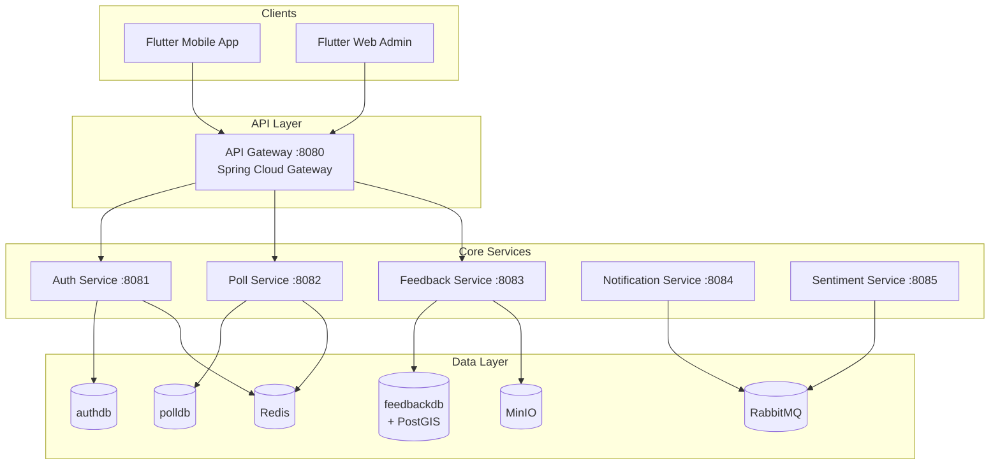
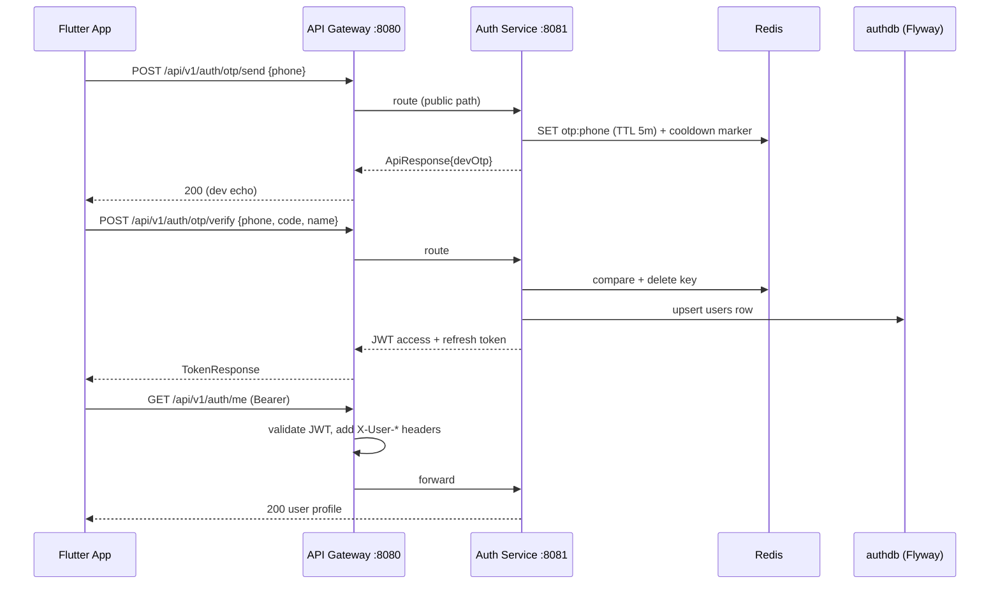

# System Architecture

## Overview

## Vertical slice (current)

## Gateway edge security

- Public paths: `/api/v1/auth/otp/**`, `/api/v1/auth/token/refresh`,
  `/actuator/**`, API docs. Everything else requires a valid Bearer JWT.
- The filter strips any client-supplied `X-User-*` header, validates the JWT
  (same HS256 secret as auth-service), then injects `X-User-Id`,
  `X-User-Role`, `X-User-Name` before routing downstream.

## Data ownership

| Service | Database | Tables |
|---|---|---|
| auth-service | `authdb` | `users` |
| poll-service | `polldb` | `polls`, `poll_options`, `poll_participation`, `ballots` |
| feedback-service | `feedbackdb` | `feedback`, `feedback_images`, `feedback_status_history`, `feedback_upvotes`, `comments` |

Cross-service references use bare `user_id` columns — no cross-database
foreign keys. Consistency comes from service APIs, not joins.

## One-person-one-vote enforcement

`poll_participation` uses composite PK `(poll_id, user_id)`; a second vote
violates the primary key inside the same transaction as the ballot insert,
so duplicates are impossible even under concurrency. Ballots are anonymous.

## Future phases

- **Async** (done for feedback): feedback-service publishes
  `feedback.created` / `feedback.status.changed` to the
  `feedbackapp.events` topic exchange; notification-service consumes them
  and exposes `/api/v1/notifications/recent` (admin). Sentiment scoring and
  FCM push will consume the same events.
- **Real-time** (done for polls): STOMP WebSocket at `/ws` (routed by the
  gateway with `ws://` scheme, public handshake). Vote transactions publish
  an AFTER_COMMIT event that broadcasts fresh results to
  `/topic/polls/{id}` — clients update without polling.
- **Scale** (weeks 9-10): Kubernetes HPA, Prometheus/Grafana, Loki logging
  (see `k8s/` for the manifest pattern).
