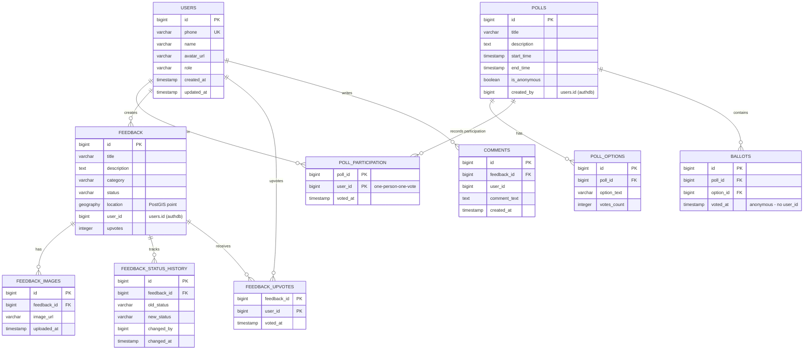

# Database Schema

Three logical databases, one per owning service. PostGIS is enabled in
`feedbackdb`. Migrations are Flyway SQL files inside each service
(`src/main/resources/db/migration`).



## Key design decisions

1. **Composite PK on `poll_participation`** — `(poll_id, user_id)` makes a
   second vote by the same citizen physically impossible; uniqueness is
   enforced by the database, not application code.
2. **Anonymous ballots** — `ballots` has no `user_id`. The participation
   table proves *that* a user voted; ballots record *what* was counted.
   Published tallies can never be traced to a voter.
3. **PostGIS `GEOGRAPHY(POINT,4326)` + GIST index** — metro-aware distance
   queries (`ST_DWithin`) for the "issues near me" map.
4. **Status audit trail** — every transition of `feedback.status` is a row in
   `feedback_status_history` (who, when, from, to), giving the admin
   accountability trail and the data for resolution-time KPIs.
5. **No cross-database FKs** — `user_id` columns reference users logically;
   the data boundary matches the service boundary.

## Applying migrations

Each service applies its own migrations at startup (`flyway.enabled=true`):

```bash
docker compose -f infra/docker-compose.yml up -d
cd backend
./mvnw -pl auth-service spring-boot:run        # applies V1__create_users.sql to authdb
./mvnw -pl poll-service spring-boot:run        # applies V1__create_polls.sql to polldb
./mvnw -pl feedback-service spring-boot:run    # applies V1__create_feedback.sql to feedbackdb
```

Inspect with:

```bash
docker exec feedbackapp-postgres psql -U feedback -d authdb -c '\dt'
docker exec feedbackapp-postgres psql -U feedback -d feedbackdb -c '\d feedback'
```
